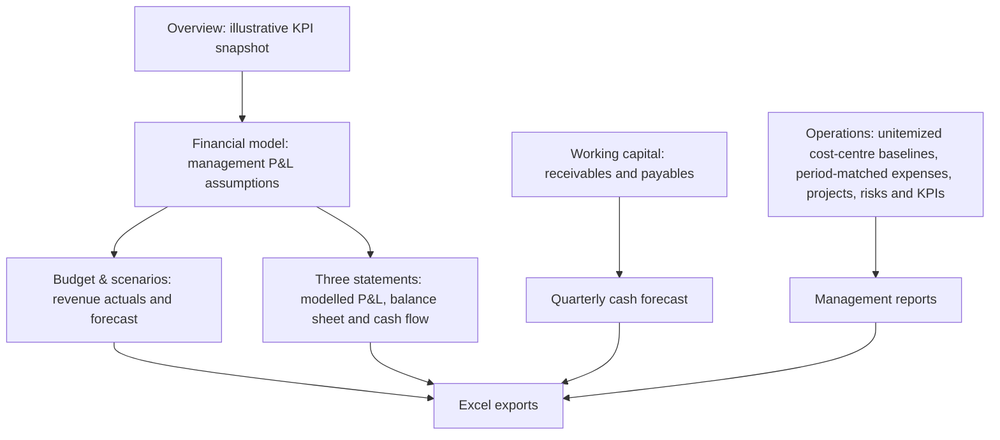
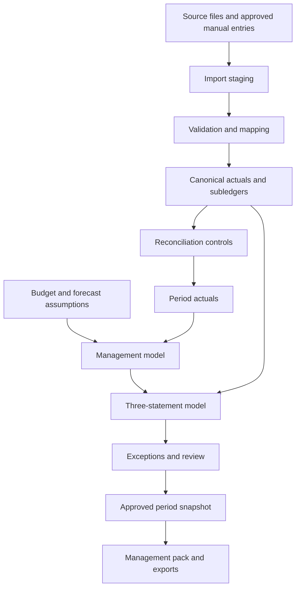

# EnterpriseOS — core finance workflow

**Mapped:** 9 November 2026  
**Purpose:** define the customer job before adding more screens or integrations.

## Target user job

A finance lead or owner at a small or medium-sized business needs to produce a reliable monthly management review: understand what happened, explain differences from plan, assess near-term liquidity and share a consistent report with decision-makers.

The workflow should take the user from source records to a reviewable decision pack. It should not require copying totals between unrelated screens.

## Current application flow

This describes the current screen-level journey, not a fully integrated accounting data flow. The P&L, planning model, three-statement assumptions, invoice register, cash forecast and operations records have different state and persistence boundaries.

## Current gaps that matter

1. **No unified actuals ledger.** Revenue actuals, expense records and invoice balances are not yet a single reconciled set of posted transactions.
2. **No canonical period object.** Screens need one shared definition of month, quarter, financial year, fiscal-year start, currency and reporting basis.
3. **No source provenance.** A figure should eventually identify whether it came from an import, manual adjustment, invoice, forecast assumption or calculation.
4. **No close process.** There is no formal review, approval, locked period, reopening reason or immutable close snapshot.
5. **No end-to-end reconciliation.** Exporting several workbooks does not prove that their totals reconcile to one source of truth.
6. **No shared workspace.** Browser-local data cannot support a finance team working across devices.

Cost-centre budgets use a manual unitemized baseline plus dated expense records. Expense dates must fall within the linked cost-centre period; paid and unpaid expense records both count toward spend. The baseline has no transaction-level source, so the system cannot automatically detect a duplicate amount entered both as baseline and as an expense. The UI therefore defines the baseline as spend not itemised in the register and explains that it must not overlap. Run-rate projections carry the baseline as fixed spend and extrapolate only dated expenses.

These are architecture and workflow gaps, not merely missing buttons. They should be solved in the right order.

## Target monthly management-review workflow

| Step | User action | EnterpriseOS responsibility | Required control |
|---:|---|---|---|
| 1 | Select company and reporting period | Establish fiscal period, base currency and reporting basis | Period definition is consistent across every module |
| 2 | Bring in source data | Import structured revenue, expenses, invoices and balances | Preview, mapping, validation and duplicate detection |
| 3 | Resolve data issues | Show missing mappings, invalid dates, duplicates and outliers | No silent dropping or silent correction of financial records |
| 4 | Reconcile actuals | Compare imported totals with source control totals and opening balances | Differences are visible and explained |
| 5 | Review P&L | Present actual vs budget vs prior period vs forecast | Every line has a source, period and calculation definition |
| 6 | Review working capital | Age receivables/payables and explain DSO/DIO/DPO movement | Invoice balances reconcile to the relevant control totals |
| 7 | Review liquidity | Project collections, payments, financing and minimum cash | Linked and manual cash movements are distinguishable |
| 8 | Review three statements | Roll P&L into cash flow and balance sheet | Balance sheet balances; cash movement reconciles |
| 9 | Resolve exceptions | Assign owner, severity, explanation and due date | Unresolved high-severity issues block period close |
| 10 | Close and publish | Save a versioned snapshot and export the management pack | Approval, timestamp, audit trail and controlled reopening |

## Target data flow

The canonical actuals layer should be designed before bank feeds or accounting integrations. It needs explicit source IDs, effective dates, posting periods, currency, amount/sign convention, account/category mapping, cost centre, import batch and reversal/correction metadata.

## What the first version should not pretend to do

- It must not call manually entered sample assumptions “booked actuals”.
- It must not imply that an invoice register is a general ledger.
- It must not claim that a cash forecast is bank-reconciled.
- It must not call an illustrative opening balance sheet a customer balance sheet.
- It must not mark a period closed if its reconciliation checks are incomplete.
- It must not use an AI explanation to conceal a missing source or unexplained variance.

## Decisions to validate with users

Before implementing the full close workflow, discovery should answer:

- Which accounting/export format do target businesses already use?
- Who prepares, reviews and approves the monthly pack?
- What is the minimum acceptable source data for a useful first report?
- Which reconciliations are performed every month, and which are painful?
- Are users more constrained by data collection, mapping, explaining variances or producing the final report?
- How are fiscal years, VAT, multi-currency and intercompany transactions handled in the target segment?

Do not add all accounting standards or country-specific rules at once. Choose the first customer segment and jurisdiction, then scope the correct accounting semantics.
